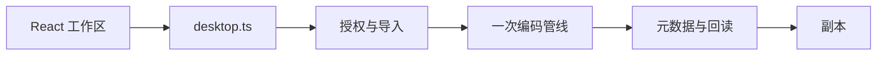

# 纯钧技术架构

用户已经比较并选择 **Tauri 2 + Rust + React + TypeScript**，单个本地桌面程序，Windows 11 优先。无远程 API、账号、云存储、遥测、容器、Redis 或数据库服务。Vite 只在开发时运行，发行应用嵌入本地静态界面。图片处理在 Rust 内完成，偏好和历史使用应用数据目录里的 JSON。

## 已有骨架

| 位置                          | 已有职责                                                      |
| ----------------------------- | ------------------------------------------------------------- |
| `src/App.tsx`                 | 压缩、转换、裁剪、水印与声明、设置；进度、失败和未达标        |
| `src/platform/desktop.ts`     | 唯一桌面桥接入口                                              |
| `src-tauri/src/lib.rs`        | 命令、任务暂停/取消和本机 JSON                                |
| `src-tauri/src/grant.rs`      | 授权 ID、符号链接拒绝、冲突编号                               |
| `src-tauri/src/image_ops.rs`  | 解码、裁剪、缩放、明水印和 JPEG/PNG/WebP/AVIF 编码            |
| `src-tauri/src/metadata.rs`   | EXIF/XMP/AIGC 与 C2PA 容器状态                                |
| `src-tauri/src/migration.rs`  | 重编码容器迁移：EXIF/ICC/XMP/PNG 块提取、定点手术、注入与复检 |
| `src-tauri/src/window_fit.rs` | 启动时按显示器工作区适配窗口，必要时先钳尺寸再最大化          |
| `src-tauri/capabilities`      | 主窗口、事件和对话框；不开放任意文件系统、Shell 或 HTTP       |

## 2026-11-04 审查后的保护边界

- `import_paths` 只消费 Rust 实际接收的原生拖放路径，不能通过前端传任意路径获取读取授权；选择框仍在 Rust 打开。
- 编码并发，目标命名/落盘串行；独占临时文件写完并同步后，编号/跳过策略用硬链接独占创建目标，替换策略用 rename 替换目录项，不先删除旧副本。不能创建硬链接的卷会明确失败，FAT/exFAT/网络卷兼容方案待开发。
- 导出防护覆盖本次任务启动时所有已导入的源文件；报告采用编号副本。尚未提供跨进程全局命名锁，文件/目录被外部替换的竞态和 Windows 重解析点需继续收紧。
- 元数据专用模式跳过像素管线；未知 XMP 的编辑仍拒绝，并经 `ensure_editable_xmp` 延伸到重编码叠加声明编辑的组合。重编码由 `migration.rs` 逐字节迁移 EXIF/ICC/XMP 与 PNG 文本/色彩块到 JPEG/PNG 目标，迁移后重新提取复检；WebP/AVIF 等无法承载的目标须 `allowMetadataLoss` 明确确认，否则拒绝。C2PA 线索不迁移并明示失效；BMP/TIFF/GIF/SVG 源暂不迁移。
- 目标体积在元数据写入后重新计算。JPEG/PNG/WebP 预览来自编码结果；AVIF 无解码器，明确标记预览和验证限制。
- 仍由 React 单文件维护较多状态，跨工作区草稿合成、持久化原子性、总内存预算和已结束任务释放尚待补齐，详见[审查登记](../reviews/2026-11-04.md)。本次不预建通用任务/插件平台。

导出界面已取消单独检查页：`App.tsx` 固定本次参数快照，读取已有证据后直接启动或展示风险；`components/ExportOptions.tsx` 承担底部展开设置、共用命名字段与确认弹窗。工作区命名不写默认偏好，默认值仍由设置命令保存。没有增加原生命令、文件权限或来源丢失绕过入口。

`components/ScrollArea.tsx` 统一滚动区域：内容仍使用原生滚动，React 浮层绘制滑块，原生滚动槽隐藏以避免占宽。观察视口和内容尺寸并随卸载清理，处理双轴滚动、拖动及键盘；适应画布可显式关闭滚动。它只负责界面，不参与图片处理或原生授权。

## 仍未实现的部分

- 自动 OCR、隐形水印检测、仿制和像素修补。没有插件市场或模型安装器。
- HEIC 解码，以及 AVIF 解码。AVIF 只从已解码像素编码。
- WebP 有损编码、JPEG 无损优化、多页 TIFF 除首页以外的页。
- C2PA 容器解析、签名校验、信任链和远程撤销。目前只报告字节线索，不证明容器有效。
- 重新编码时的 sRGB 色彩转换与 HDR 管理（ICC 档案已随 JPEG/PNG 副本迁移；BMP/TIFF/GIF/SVG 源不迁移）。
- 厂商原始样本验收。没有样本时界面保持“适配目标”。

## 发行边界

版本在 package/Cargo/Tauri 配置保持一致，依赖由两份锁文件固定。Windows NSIS 选择 current-user、WebView2 `embedBootstrapper`（内嵌约 2MB 引导器，缺失时联网下载运行时，安装包因此从 213MB 降到 6MB 量级），只生成对应桌面配置，不生成服务器部署资产。正式发布前仍需基础 OCR 资源、签名、清洁机器首次断网安装/运行/卸载和回退验证。macOS 未作为本次已验证目标。
